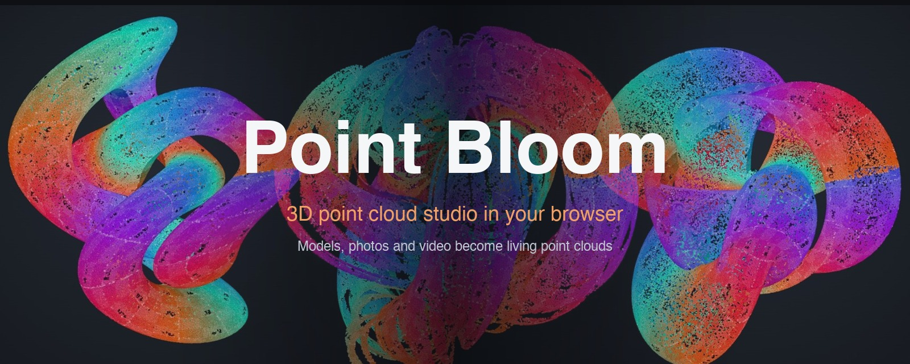
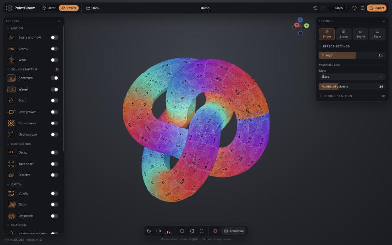
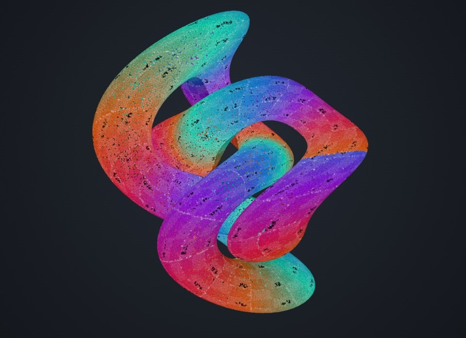
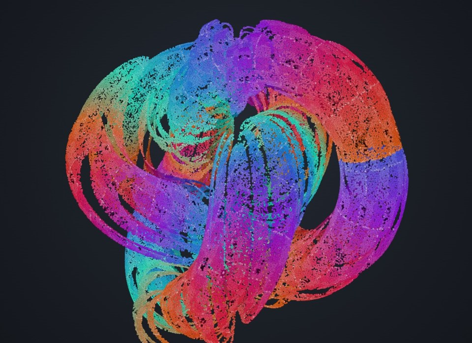
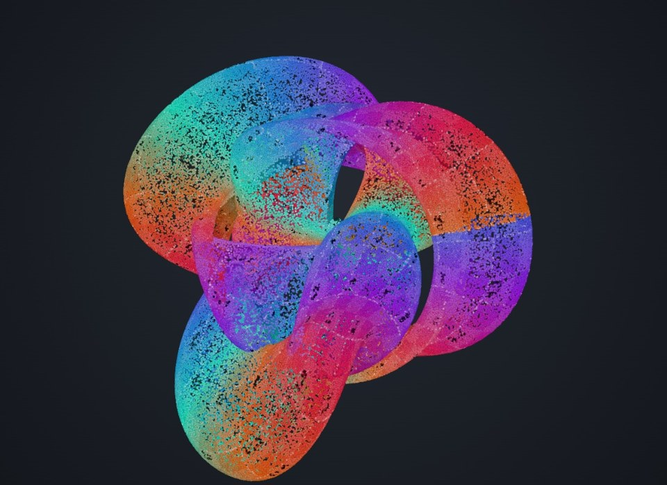
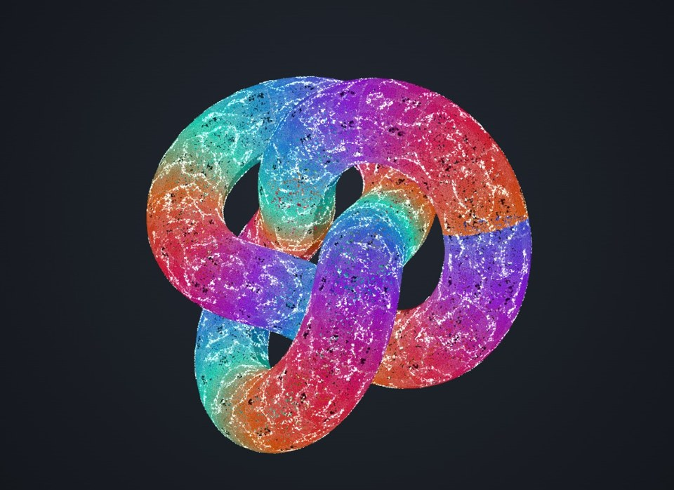
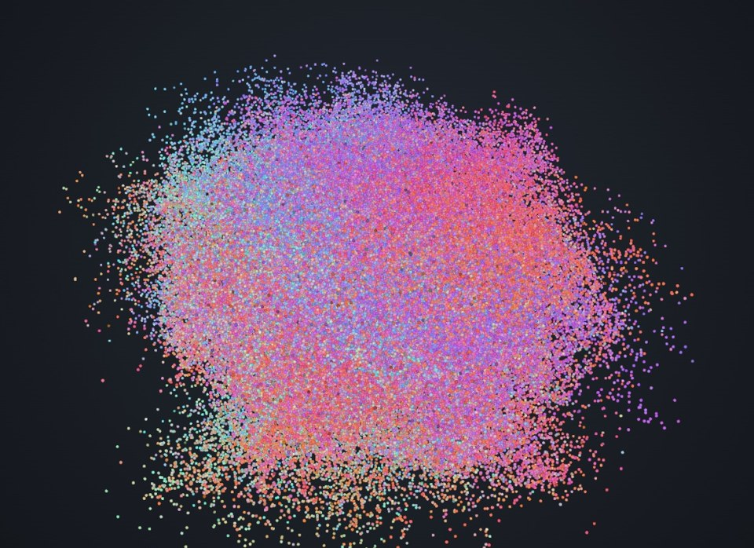
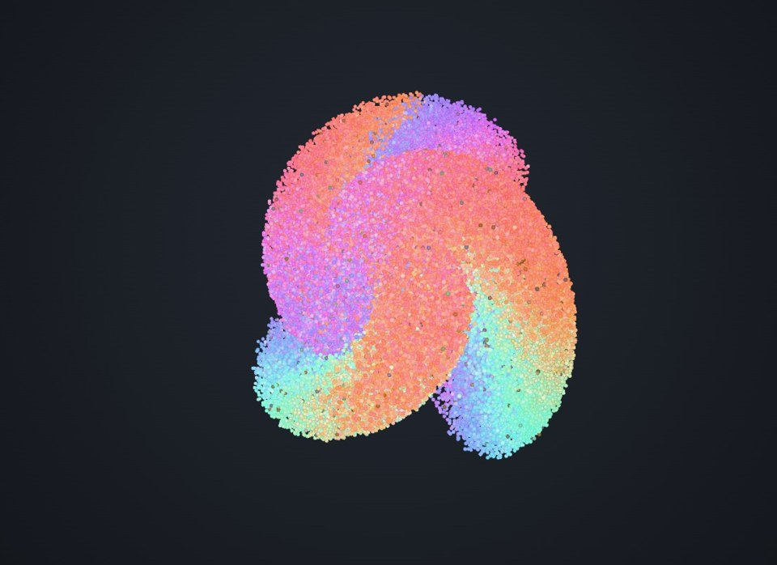
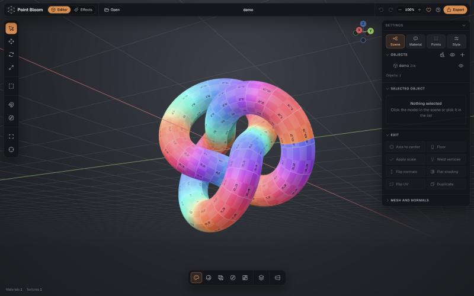

<div align="center">



# Point Bloom

**A point cloud studio in your browser.** Turn 3D models, photos and video into living point clouds, add music-driven effects, morph between shapes and record it all to video.

[](https://pointbloom.vercel.app)


[Русская версия](README.md)

</div>

---

## What it is

Point Bloom runs entirely in the browser: no server, no sign-up, no install. Files are processed on your computer and never uploaded.

Two tools in one window:

- **Editor.** Opens models (OBJ, GLB, FBX, STL, PLY and more), edits materials, textures and meshes, builds point clouds and exports to GLB, glTF, USDZ, PLY, STL or a ready-made web page.
- **Effects mode.** Everything runs on the GPU. A model, photo or video becomes a point cloud, and a chain of independent effects reacts to music, the mouse and your hands in front of the camera. The result is recorded to MP4.

<div align="center">

</div>

## Gallery

All frames were made in the app itself on the demo model from `samples/`.

<table>
<tr>
<td width="33%"><br><sub><b>Deform</b>: twist, bend, snake, breathe</sub></td>
<td width="33%"><br><sub><b>Spectrum</b>: the shape answers the sound</sub></td>
<td width="33%"><br><sub><b>Waves</b>: drops, rings, spiral</sub></td>
</tr>
<tr>
<td width="33%"><br><sub><b>Links</b>: glowing threads between points</sub></td>
<td width="33%"><br><sub><b>Morphing</b>: the Flow transition mid-way</sub></td>
<td width="33%"><br><sub><b>Morphing</b>: the Portal transition</sub></td>
</tr>
</table>

## Quick start

1. Open **[pointbloom.vercel.app](https://pointbloom.vercel.app)** (or `index.html` from this folder: the build works without a server).
2. Drop a model file into the window. For `.obj`, drop it together with the `.mtl` and textures, or a whole folder or `.zip`. To try it, press **Demo model**.
3. For effects, switch **Editor / Effects** in the header (key `E`) and turn effects on in the left panel.
4. For a file, press **Export** (or `Ctrl+E`) and pick a format.

<div align="center">

</div>

## Features

### Editor

| | |
|---|---|
| **Input formats** | OBJ (+MTL), GLB, glTF, FBX, DAE, STL, PLY, 3DS, 3MF, AMF, USDZ, PCD, XYZ, OFF, ZIP archives. Textures: PNG, JPG, WebP, BMP, GIF, TGA |
| **Output formats** | GLB, glTF, USDZ (AR on iPhone), a ready web page, OBJ+MTL+textures (ZIP), PLY (mesh or point cloud), STL. Quick presets: web, AR on iPhone, game, print |
| **Materials** | PBR slots (color, normal, roughness, metalness, AO, emissive), map type detected from the file name, repeat and offset, transparency, UV preview |
| **Editing** | mesh simplification that keeps UVs, move, rotate, scale, weld vertices, flip normals, mirror, duplicate, undo and redo |
| **Point clouds** | vertices or even surface sampling with texture color; circle, square, sphere, ring, diamond, plus; the "Your computer" card suggests a comfortable point count |
| **Photo and video to points** | point color from the pixel, height from brightness; video can be recorded into a point clip (`.pcv`), PLY frames, or a frame placed into the scene |
| **Animation** | skeletal character animation (a demo animation is built in); the camera frames the whole motion |

### Effects mode

The idea comes from TouchDesigner POPs: a chain of independent operators over a point cloud. Every effect has its own settings and its own sound reaction (bass, mid, high, beat; smooth or threshold).

| Group | Effects |
|---|---|
| **Video** | Depth volume, Pixel sort, Storyboard, Motion trail, Slit-scan |
| **Motion** | Swirls and flow, Gravity, Deform |
| **Sound and rhythm** | Spectrum, Waves, Blast, Beat growth, Sound sand (Chladni figures), Oscilloscope |
| **Destruction** | Decay, Take apart, Dissolve |
| **Digital** | Voxels, Glitch, Datamosh |
| **Graphics** | Shadow on the wall, Links, Slice, Time trails, Echo, Tracking frames |
| **Control** | Cursor, Brush (watercolor on the shape), Hands (camera) |
| **Experiments** | Hyperspace (the fourth dimension), Screen (video plays on the shape) |

#### Morphing

Smooth transitions between models, photos and videos in any combination.

- **Shapes:** any scene objects, videos and photos (up to six at once). All shapes share one point count, so transitions have no seams.
- **Transition styles:** Flow, Swirl, Burst, Scanner, Dust, Sand, Through 4D, Through a sphere, Blocks, Flattening, Relief (from a neural depth map), Portal, Magnet.
- **Triggering:** by button, by timer or **to music**: a jump on a burst in the chosen frequencies, or smooth, with the shape following the loudness.
- A manual progress slider, order (loop, back and forth, random), duration, scatter, twist, point size in flight.
- Video keeps playing while points scatter and restarts as they gather. Sound can be pinned to any video.
- Animated models keep moving during the transition.

#### Sound

A built-in synthesizer (three styles), your own audio file, the microphone or the sound of an open video. Without sound the scene stays alive.

#### Hands and camera

Hand tracking through MediaPipe. Each gesture (palm, fist, pinch, index finger) gets an action: push, pull, swirl, sculpt clay, gravity, shockwave, decay, glowing trail. Ready schemes: Game, Sculptor, Space, Magic. Camera video never leaves the browser.

#### Timeline and recording

- **Keyframe animation:** camera, size, brightness and effect strength change smoothly along a time track; effect blocks can be dragged, cut and repeated, and morph blocks run in a chain.
- **Video recording** with sound: MP4 (H.264/AAC via WebCodecs), selectable quality, exact frame size with the scene background. The timeline is recorded frame by frame with no dropped frames.

## How it works

- **Rendering:** three.js. WebGPU is the default on Windows and Linux, WebGL on Mac; if WebGPU fails the app switches by itself. Effect shaders are written once in GLSL and the WGSL for WebGPU is generated from them by `dev/gen-wgsl.mjs`.
- **Privacy:** files, camera and microphone are processed locally. Only libraries from the CDN and neural network models (hand tracking and depth) are downloaded, and only when you turn those features on.
- **Install as an app:** the site can be added to the desktop or phone home screen (PWA).
- **Interface languages:** Russian, Ukrainian, English, Spanish, German, picked from the browser settings.

## Requirements

A modern browser with WebGL 2; works best in Chrome and Edge. WebGPU is optional. A discrete or modern integrated GPU is recommended for effects: the "Your computer" card measures speed and suggests a comfortable point count.

Mouse and keyboard controls: **[docs/CONTROLS.md](docs/CONTROLS.md)** (in Russian).

## Build

Only Python 3 is needed, no Node.js.

```bash
python3 build.py            # build assets/app.js (index.html opens by double click)
python3 build.py --watch    # rebuild on every save
python3 build.py --web      # build the light version for publishing into web/
```

Publishing: the `web/` folder is ready for any static host (about 300 KB, three.js and icons from a CDN). The Vercel security headers (`vercel.json`) are generated by the same `build.py`.

## Project layout

```
index.html        the app page
assets/           app.js (built), styles, Geist fonts, app icons
src/              source as ES modules (details: src/README.md)
dev/              developer tools: module check, WGSL generation, effects smoke test
docs/             documentation: controls, design brief, effects inventory, WebGPU report
samples/          demo model: demo.obj + demo.mtl + demo_texture.png
vendor/           three.js (MIT), Phosphor icons (MIT)
web/              light version for publishing (made by build.py --web)
build.py          the builder
```

Before changing the interface read **[docs/DESIGN.md](docs/DESIGN.md)** (in Russian): colors, sizes, icons and layout rules.

## Known limitations

- Draco-compressed models are not supported yet.
- Animations and skeletons are not saved on GLB export.
- Units: glTF uses meters. For models from CAD or FBX (millimeters, centimeters) pick a scale on the Export tab.

## Licenses

Project source code: all rights reserved, see [LICENSE](LICENSE). Third-party: three.js (MIT), Phosphor icons (MIT), Geist font (SIL OFL), GLB validation during development: Khronos glTF Validator.
