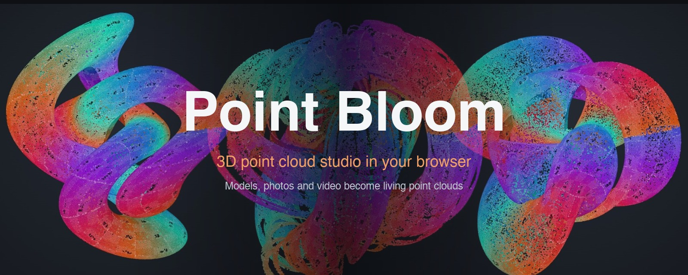
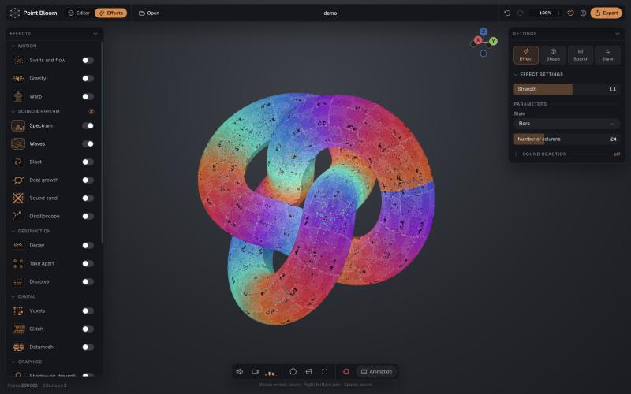
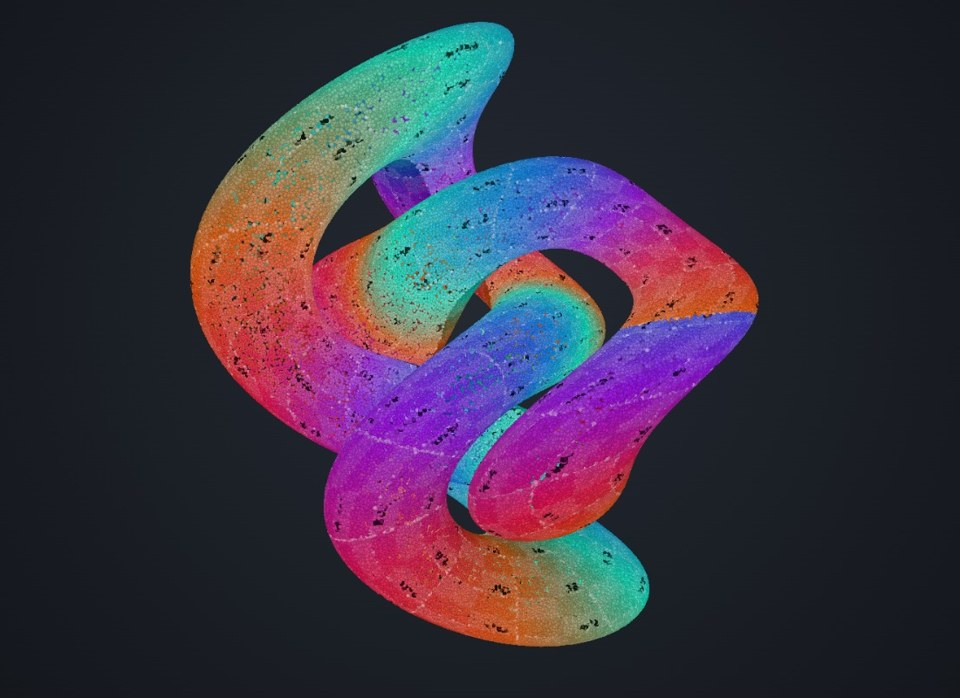
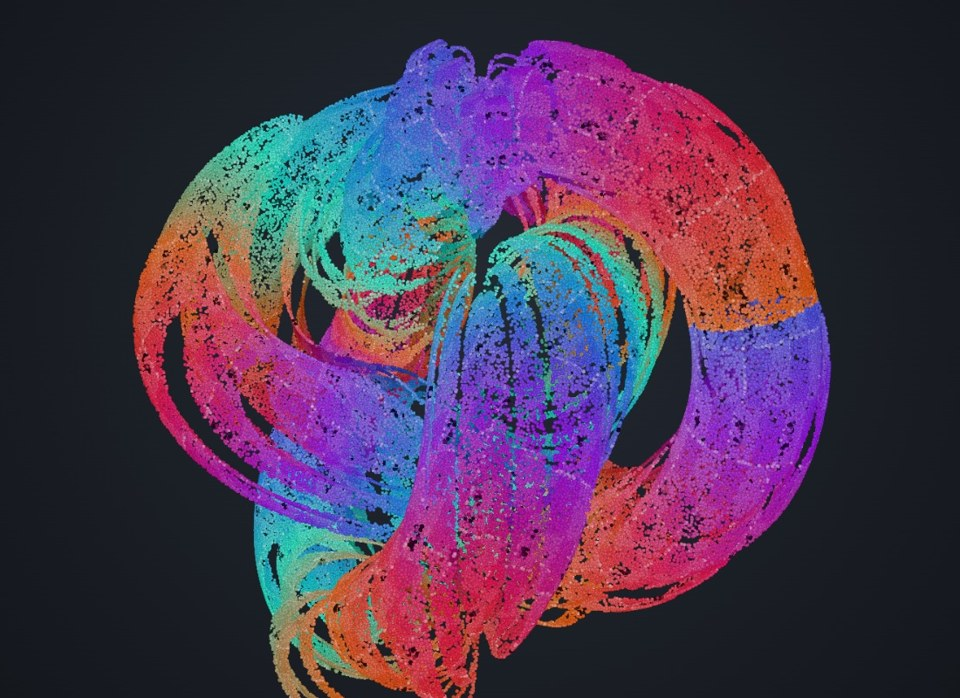
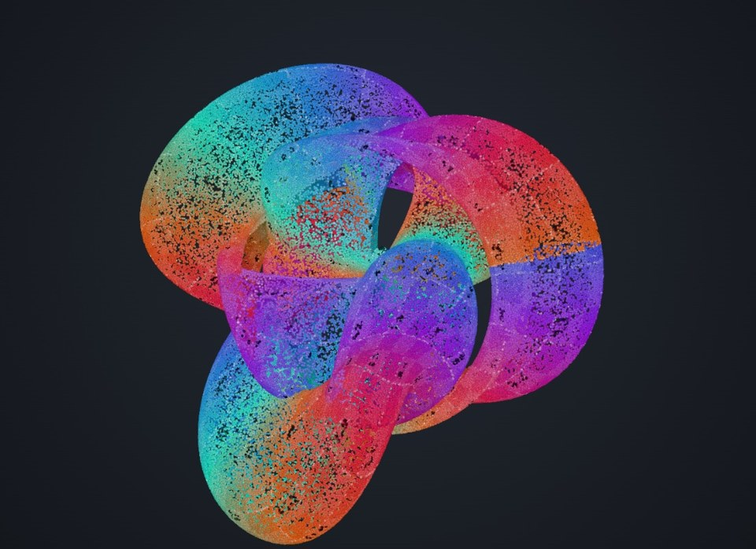
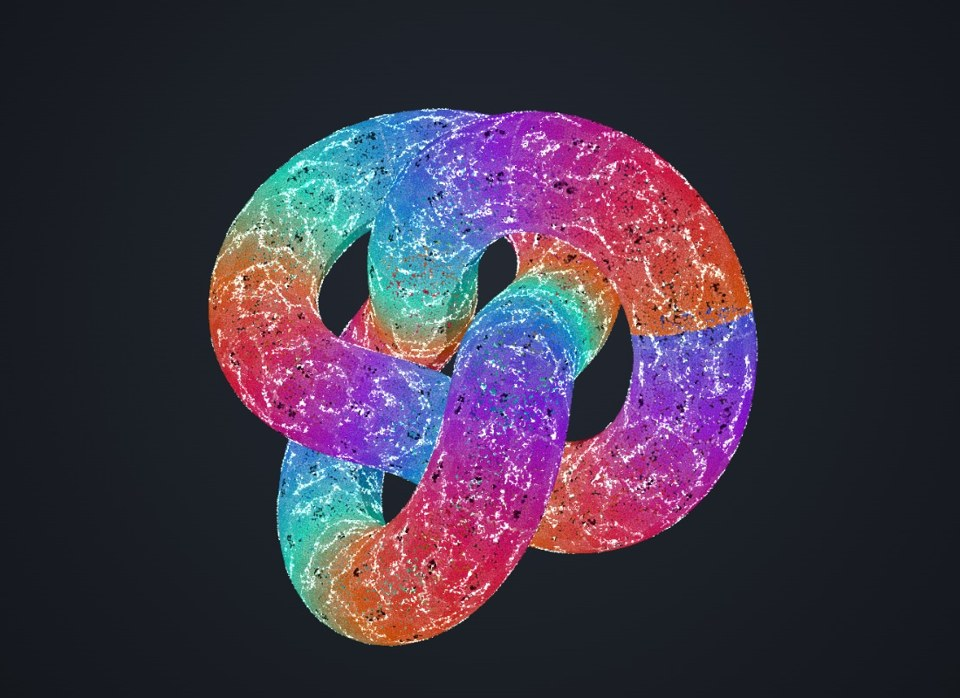
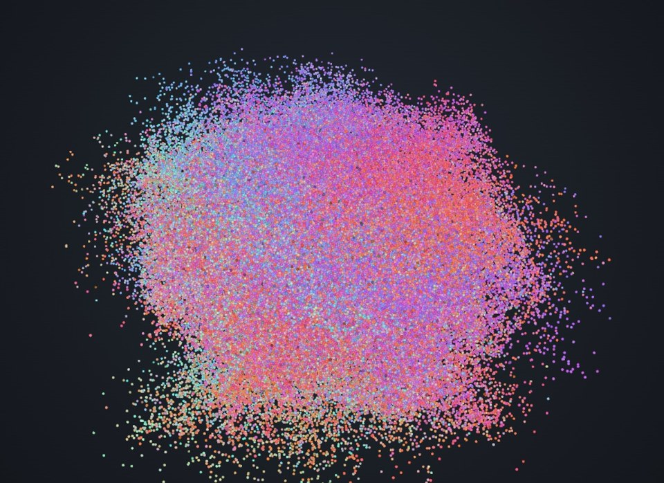
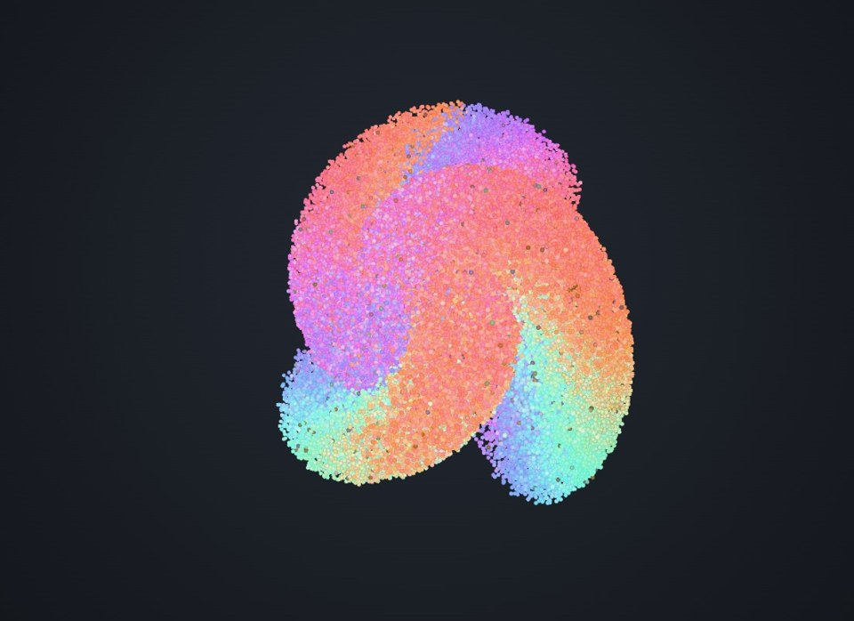
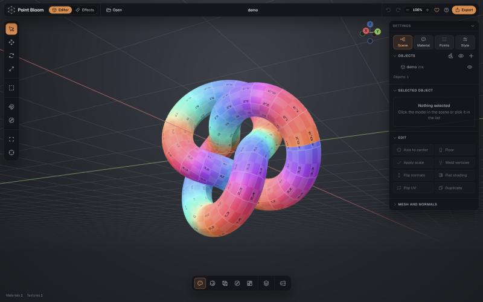

<div align="center">



# Point Bloom

**Студия облаков точек в браузере.** Превращайте 3D-модели, фото и видео в живые облака точек, добавляйте эффекты под музыку, делайте морфинг между формами и записывайте всё в видео.

[](https://pointbloom.vercel.app)


[English version](README.en.md)

</div>

---

## Что это

Point Bloom работает целиком в браузере: ни сервера, ни регистрации, ни установки. Файлы обрабатываются на вашем компьютере и никуда не отправляются.

Это два инструмента в одном окне:

- **Редактор.** Открывает модели (OBJ, GLB, FBX, STL, PLY и ещё десяток форматов), правит материалы, текстуры и сетку, собирает облако точек и экспортирует в GLB, glTF, USDZ, PLY, STL или готовую страницу для сайта.
- **Режим «Эффекты».** Всё считается на видеокарте. Из модели, фото или видео получается облако точек, и над ним работает цепочка независимых эффектов, которые реагируют на музыку, мышь и руки перед камерой. Результат записывается в MP4.

<div align="center">

</div>

## Галерея

Все кадры ниже сделаны в самом приложении на демо-модели, которая лежит в `samples/`.

<table>
<tr>
<td width="33%"><br><sub><b>Деформация</b>: скрутка, изгиб, змейка, дыхание</sub></td>
<td width="33%"><br><sub><b>Спектр</b>: форма отзывается на звук</sub></td>
<td width="33%"><br><sub><b>Волны</b>: капли, кольца, спираль</sub></td>
</tr>
<tr>
<td width="33%"><br><sub><b>Связи</b>: светящиеся нити между точками</sub></td>
<td width="33%"><br><sub><b>Морфинг</b>: переход «Течение» посередине пути</sub></td>
<td width="33%"><br><sub><b>Морфинг</b>: переход «Портал»</sub></td>
</tr>
</table>

## Быстрый старт

1. Откройте **[pointbloom.vercel.app](https://pointbloom.vercel.app)** (или `index.html` из этой папки: сборка работает и без сервера).
2. Перетащите в окно файл модели. Для `.obj` бросайте сразу вместе с `.mtl` и текстурами, либо целую папку или `.zip`. Для пробы нажмите **«Демо-модель»**.
3. Хотите эффекты: переключите **«Редактор / Эффекты»** в шапке (клавиша `E`), слева включите нужный эффект.
4. Хотите файл: **«Экспорт»** (или `Ctrl+E`), выберите формат.

<div align="center">

</div>

## Возможности

### Редактор

| | |
|---|---|
| **Форматы на входе** | OBJ (+MTL), GLB, glTF, FBX, DAE, STL, PLY, 3DS, 3MF, AMF, USDZ, PCD, XYZ, OFF, архивы ZIP. Текстуры: PNG, JPG, WebP, BMP, GIF, TGA |
| **Форматы на выходе** | GLB, glTF, USDZ (AR на iPhone), готовая страница для сайта, OBJ+MTL+текстуры (ZIP), PLY (сетка или облако точек), STL. Быстрые сценарии: «Для сайта», «AR на iPhone», «Для игры», «Для печати» |
| **Материалы** | PBR-слоты (цвет, нормали, шероховатость, металличность, AO, свечение), тип карты определяется по имени файла, повтор и смещение, прозрачность, предпросмотр UV |
| **Правка** | упрощение сетки с сохранением UV, перемещение, вращение, масштаб, склейка вершин, выворот нормалей, отражение, дублирование, отмена и повтор |
| **Облака точек** | вершины или равномерная выборка с цветом из текстуры; круг, квадрат, шар, кольцо, ромб, плюс; карточка «Ваш компьютер» подсказывает, сколько точек комфортно |
| **Фото и видео в точки** | цвет точки из пикселя, высота по яркости; видео можно записать в точечный ролик (`.pcv`), в PLY-кадры или поставить кадр в сцену |
| **Анимация** | скелетная анимация персонажей (демо-анимация внутри), камера охватывает всё движение |

### Режим «Эффекты»

Идея из TouchDesigner POP: цепочка независимых «операторов» над облаком точек. У каждого эффекта свои настройки и своя реакция на звук (бас, середина, верх, удар; плавно или по порогу).

| Группа | Эффекты |
|---|---|
| **Видео** | Объём по глубине, Пиксельная сортировка, Раскадровка, Шлейф движения, Слит-скан |
| **Движение** | Вихри и течение, Гравитация, Деформация |
| **Звук и ритм** | Спектр, Волны, Взрыв, Рост на ритме, Звуковой песок (фигуры Хладни), Осциллограф |
| **Разрушение** | Распад, Разбор на части, Растворение |
| **Цифровые** | Воксели, Глитч, Датамош |
| **Графика** | Тень на стене, Связи, Срез, Следы времени, Эхо, Рамки слежения |
| **Управление** | Курсор, Кисть (акварель по форме), Руки (камера) |
| **Эксперименты** | Гиперпространство (четвёртое измерение), Экран (видео играет на форме) |

#### Морфинг

Плавные переходы между моделями, фото и видео в любых сочетаниях.

- **Формы:** любые объекты сцены, видео и фото (до шести сразу). У всех форм одинаковое число точек, поэтому переход идёт без швов.
- **Виды перехода:** Течение, Вихрь, Взрыв, Сканер, Пыль, Осыпание, Через 4D, Через сферу, Кубики, Сплющивание, Рельеф (по карте глубины от нейросети), Портал, Магнит.
- **Запуск:** кнопкой, по таймеру или **под музыку**: скачком на всплеск выбранных частот или плавно, форма идёт за громкостью.
- **Ручной ползунок** перехода, порядок «по кругу», «туда и обратно» или случайный, длительность, разлёт, закрутка, размер точек в пути.
- Видео играет, пока точки разлетаются, и запускается снова, когда они собираются. Звук можно закрепить за любым видео.
- Анимированные модели продолжают двигаться во время перехода.

#### Звук

Встроенный синтезатор (три стиля), свой аудиофайл, микрофон или звук открытого видео. Без звука сцена остаётся живой.

#### Руки и камера

Распознавание рук через MediaPipe. Каждому жесту (ладонь, кулак, щипок, указательный палец) назначается действие: оттолкнуть, притянуть, вихрь, лепить глину, гравитация, ударная волна, распад, светящийся след. Есть готовые схемы: «Игра», «Скульптор», «Космос», «Магия». Видео с камеры не покидает браузер.

#### Таймлайн и запись

- **Анимация по ключам:** камера, размер, яркость и сила эффектов плавно меняются на дорожке времени; блоки эффектов можно перетаскивать, резать, повторять, а блоки морфинга идти цепочкой.
- **Запись видео** со звуком: MP4 (H.264/AAC через WebCodecs), качество на выбор, кадр точного размера с фоном сцены. Таймлайн записывается покадрово, без пропусков.

## Как это работает

- **Рендер:** three.js. На Windows и Linux по умолчанию WebGPU, на Mac WebGL; если WebGPU не заработал, приложение само переключается. Шейдеры эффектов пишутся один раз на GLSL, а WGSL для WebGPU генерируется из них скриптом `dev/gen-wgsl.mjs`.
- **Приватность:** файлы, камера и микрофон обрабатываются локально. Из сети загружаются только библиотеки с CDN и модели нейросетей (распознавание рук и глубина), и только когда вы включаете эти функции.
- **Установка как приложения:** сайт можно поставить на рабочий стол или экран телефона (PWA).
- **Языки интерфейса:** русский, украинский, английский, испанский, немецкий. Язык выбирается по настройкам браузера.

## Требования

Современный браузер с WebGL 2; лучше всего работает в Chrome и Edge. WebGPU необязателен. Для эффектов желательна дискретная или современная встроенная видеокарта: карточка «Ваш компьютер» измеряет скорость и подсказывает, сколько точек комфортно.

Горячие клавиши и управление мышью: **[docs/CONTROLS.md](docs/CONTROLS.md)**.

## Сборка

Нужен только Python 3, Node.js не требуется.

```bash
python3 build.py            # собрать assets/app.js (index.html открывается двойным кликом)
python3 build.py --watch    # пересобирать при каждом сохранении
python3 build.py --web      # собрать лёгкую версию для публикации в web/
```

Публикация: папка `web/` готова к загрузке на любой статический хостинг (около 300 КБ, three.js и иконки с CDN). Заголовки безопасности для Vercel (`vercel.json`) генерируются тем же `build.py`.

## Структура проекта

```
index.html        страница приложения
assets/           app.js (готовая сборка), стили, шрифты Geist, иконки приложения
src/              исходный код на ES-модулях (подробно: src/README.md)
dev/              инструменты разработчика: проверка модулей, генерация WGSL, дымовой тест эффектов
docs/             документация: управление, дизайн-бриф, инвентарь эффектов, отчёт по WebGPU
samples/          демо-модель: demo.obj + demo.mtl + demo_texture.png
vendor/           three.js (MIT), иконки Phosphor (MIT)
web/              лёгкая версия для публикации (создаётся build.py --web)
build.py          сборщик
```

Перед изменениями интерфейса прочитайте **[docs/DESIGN.md](docs/DESIGN.md)**: там цвета, размеры, значки и правила оформления.

## Известные ограничения

- Модели со сжатием Draco пока не поддерживаются.
- Анимации и скелеты при экспорте в GLB не сохраняются.
- Единицы: glTF использует метры. Для моделей из CAD или FBX (миллиметры, сантиметры) выберите масштаб на вкладке «Экспорт».

## Лицензии

Исходный код проекта: все права защищены, подробнее в [LICENSE](LICENSE). Сторонние компоненты: three.js (MIT), иконки Phosphor (MIT), шрифт Geist (SIL OFL), проверка GLB при разработке: Khronos glTF Validator.
